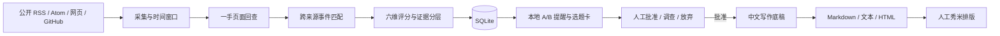

# 架构与后续扩展

## 边界和存储

| 文件 | 职责 |
|---|---|
| `sources.json`、`sources.py` | 采集地址、来源归属、解析、回查、健康记录 |
| `models.py` | 原始标题、来源时间、地区、主题、摘要及链接 |
| `editorial.py` | 规范链接、事件识别、证据排序、评分、审核、导出 |
| `writing.py` | 以事件类别和来源证据生成中文标题、导语、选题角度及批准后底稿 |
| `radar.py` | 命令、提醒文件和本地操作 |

数据库中 `items` 保存原始记录及回查证据，`events` 保存合并后的卡片和审核状态，`reviews` 保留人工决策记录，`runs` 保存每次采集的指标和信源状态。一手证据发生实质变化时，原先批准的事件回到待审。暂时网络失败保留最近一次成功证据及其时间。

事件优先按去除跟踪参数的规范链接匹配。不同链接使用五天时间窗、型号或版本与标题相似度，保留并列原始出处。这会漏掉译写差异较大的跨语言报道。需要新增语义模型前，先用真实漏判样例验证候选方案，并保留人工复核路径。

## 运营数据接口预留

未来采用显式导入或经过授权的官方接口。考虑 `publication` 关联本地事件 ID、官方文章标识、发布时间与文章链接，`metric_snapshot` 以官方文章标识、采样时间、指标名及口径作为幂等键。指标包含阅读、分享、收藏、点赞、推荐和新增关注，完读指标根据授权后实际可得字段确定。缺失值保留为空，先记录口径及统计窗口，再比较发布后同龄文章。选题分数与运营表现可按分类和阅读入口做对照。

内容升级可通过 `writing.py` 的输入输出契约增加可选的本地模型。接入外部模型前，先核查数据传递范围、费用、授权及可用性。质量验收以编辑可追溯的证据、不同型号是否错配、是否把厂商口径写成事实为主。
