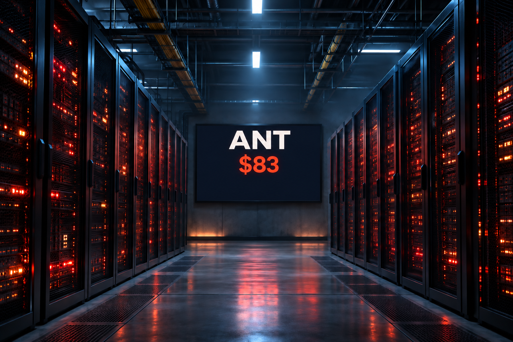
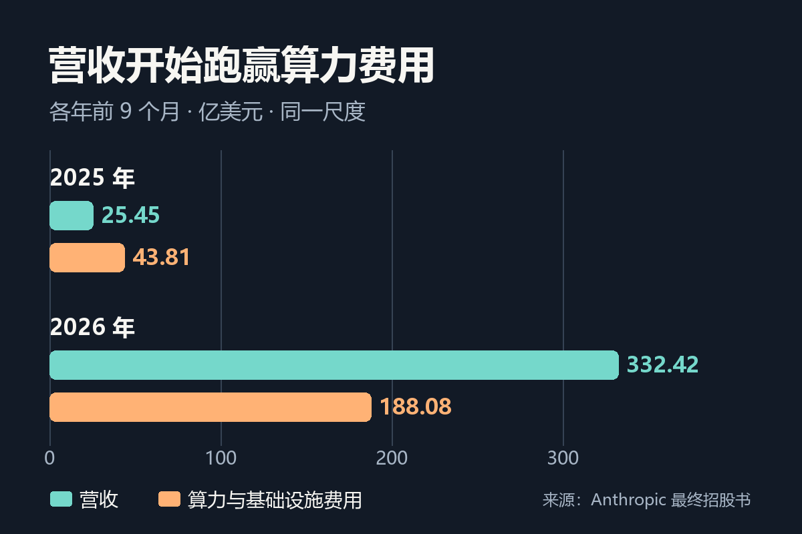

# Anthropic 上市，招股书里更大的数字是 9009 亿美元

*AI 生成概念图。83 美元是发行价。*

**813.4 亿美元。** 这是 Anthropic 以每股 83 美元、发行 9.8 亿股算出的基础 IPO 总额。11 月 19 日，做出 Claude 的这家公司以 **ANT** 为代码登陆纳斯达克。

往招股书里再翻几页，会看到一个大约是它 **11 倍** 的数字：**9009 亿美元**。这是 Anthropic 披露的采购和租赁承诺总额，几乎全部与算力和基础设施有关。其中约 **4516 亿美元**预计在 2030 年底前发生，其余绝大部分分布在 2031 至 2045 年。

把这两个数字摆在一起，AI 公司的生意忽然具体了：你在窗口里发一条消息，背后的服务器可能早在一年多前就订下了。

## 813.4 亿美元里，有多少是 Anthropic 自己卖的？

**793.77 亿美元**来自 Anthropic 出售的新股，约 **19.63 亿美元**来自原股东出售的股份。两个数字都按 83 美元的发行价计算，未扣费用。公司同期还有一笔 **260 亿美元**的私募配售。按最终招股书估算，合并计算公司发行部分与同期私募、扣除承销费用等之后，净募资约 **1048 亿美元**。

招股书列出的用途包括扩充算力和基础设施。Anthropic 说，算力往往要在可用前 **12 至 18 个月**采购。客户的用量按天变，机房和芯片得按年订。这段时间差，正是那笔巨额承诺的分量。

## 算力费用变成 4.3 倍，营收变成 13.1 倍

对比两个年份的前九个月，营收从 **25.45 亿**跳到 **332.42 亿美元**，约为原来的 **13.1 倍**。同期算力与基础设施费用从 **43.81 亿**升到 **188.08 亿美元**，约为原来的 **4.3 倍**。

*同一尺度，单位为亿美元。图表据 SEC 最终招股书绘制。*

每取得 **100 美元营收**，2025 年同期对应的算力与基础设施费用约 **172 美元**，2026 年同期降到了 **57 美元**。这笔费用覆盖研究、训练和服务用户等多种工作，仍是最大的一项经营费用。

## 模型端也在做同一件事：把一次任务做便宜

上市前十天，Anthropic 发布了 Claude Fable 5.2。它把标准 API 价格从上一代的 **每百万输入／输出 token 10／50 美元**，降到了 **8／40 美元**。两项都降了 **20%**。

Anthropic 自测的 FrontierCode 2.0 更直观。**Fable 5.2 在 High 档拿到 45.3%，Opus 5.5 在 Max 档拿到 45.5%。** 分差只有 **0.2 个百分点**，Fable 5.2 的平均任务成本约为后者的一半。该测试评估代码更改能否达到开源维护者的合入要求，数字对应厂商的评测配置。

> 对一个每天跑几千次代码任务的团队，分数接近时，每次任务省下来的钱，才是会每天出现在账单上的变化。

Anthropic 已经把未来多年的算力订下了。接下来更值得追的，是每一代 Claude 能用同样的预算，多做成多少件事。

**主要出处**　[纳斯达克上市记录](https://www.nasdaq.com/newsroom/anthropic-marks-ipo-at-nasdaq) · [SEC 最终招股书](https://www.sec.gov/Archives/edgar/data/2130357/000162828026074944/anthropicpbc-424b4.htm) · [Anthropic Fable 5.2 发布说明](https://www.anthropic.com/claude-fable-and-mythos-5-2)
