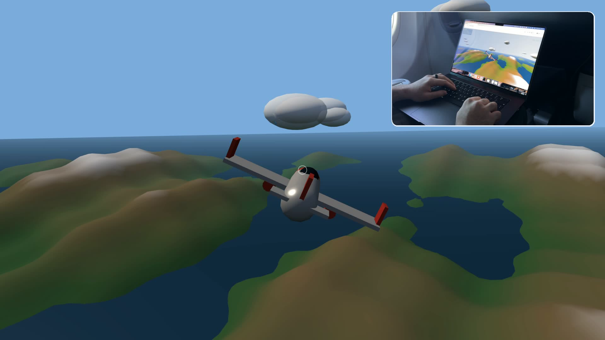
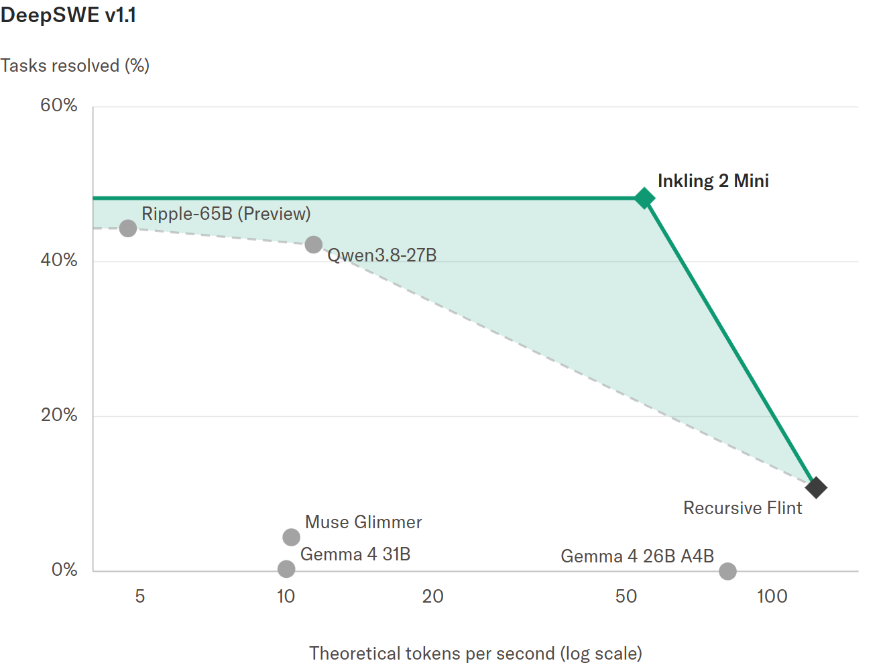
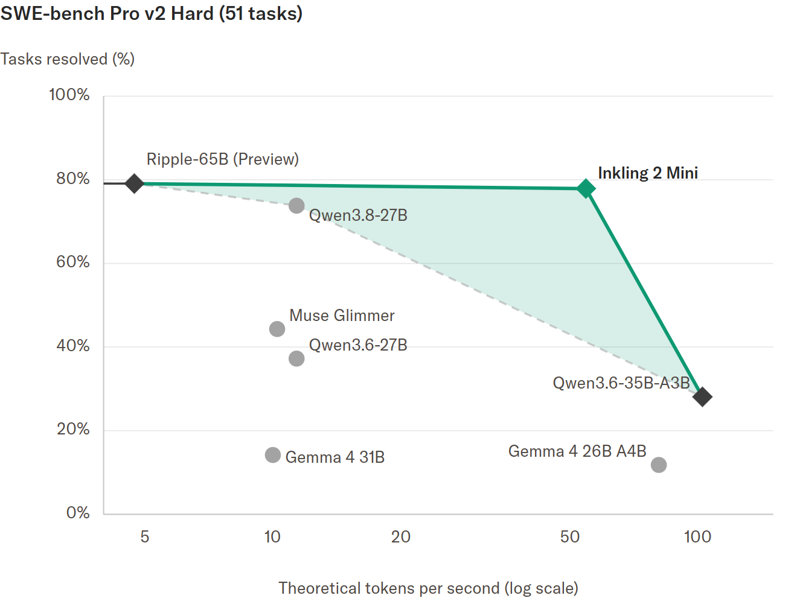

# 断网照样起飞！一台 MacBook 几分钟写出飞行模拟器

*封面为参考官方演示画面制作的 AI 创意海报。*

飞机还在天上，电脑里的飞机已经能起飞了。

Thinking Machines Lab 的研究人员用一台开启飞行模式的 **48GB MacBook Pro（M5 Pro）** 跑 Inkling 2 Mini，让它写一套飞行模拟器。按团队发布的演示，几分钟后，他们已经能在模拟器里飞一圈。

**11 月 20 日，团队把这套模型的权重公开了。** 模型卡列明 Apache 2.0。看到那段视频，我更想知道的是：把任务换成一份谁也没给它演示过的旧代码，它还能干成多少？

*视频源自 Thinking Machines Lab 官方发布页，原片大部分为 15 倍速。 [官方原视频](https://thinkingmachines.ai/_astro/planebench-demo3.FdsHOEHH.mp4)*

## 换成修代码，它领先了 6 个百分点

从头搭一个小程序是一道题。给它一份已有的代码和报错，让它改完还能跑过测试，是另一道题。

**DeepSWE v1.1** 里，Inkling 2 Mini 解决了 **48.2%** 的任务，Qwen3.8-27B 是 **42.2%**。两款模型总参数规模接近，厂商表里这项使用同一版本的测试工具。按每百道同类题换算，差距约是 **6 道**。

*图 1 来自 [Thinking Machines Lab 官网](https://thinkingmachines.ai/news/inkling-2-mini/#mini-coding-performance)。*

换到 **SWE-bench Pro v2 Hard**，这套难题一共有 **51 道**。Inkling 是 **77.9%**，Qwen 是 **73.8%**，差距缩到 **4.1 个百分点**。再换到厂商发布表的 Terminal Bench v2.1，Qwen 以 **73.0% 对 71.6%** 领先。要判断谁更适合手里的活，先看任务跟哪一种测试更像。

*图 2 来自 [Thinking Machines Lab 官网](https://thinkingmachines.ai/news/inkling-2-mini/#mini-coding-performance)。两图横轴均为理论解码速度，对应特定假设，纵轴是任务解决率。测试设置可能因模型而异。*

## 24 层，中间 12 层跑三遍

Inkling 2 Mini 有个有意思的做法。在 **24 层** 模型里，首尾各 6 层只走一遍，中间 **12 层走三遍**。碰到要处理的文本，中间那段计算会重复使用同一组权重。每个 token 一共经过 **48 次层运算**。

多跑几遍也有代价，要多做计算。团队报告里还有个分界：在它测试的循环研究版上，多跑几遍对长上下文里的检索更有帮助，对闭卷事实问答的提升很小。这个小模型也在多轮对话、复杂指令测试上落后于 Qwen。放到代码助手上，这个区别很好懂：项目里有答案，它可能更擅长翻出来。遇到它本来就不知道的知识，多算几遍的帮助有限。

## 笔记本上能跑，第一道题怎么选？

团队公布的模型内存占用约 **20GB**。飞行演示用的是 **48GB** 的 MacBook。中间的差额别急着当余量，实际部署还得看推理工具、量化版本和你一次要塞进去的代码有多长。

我会给它一道团队曾经修好的旧 Bug。用修复前的代码跑一遍，交给本地和云端模型**相同的报错、相同的代码、相同的测试**。最后只记三件事：测试过没过、耗时多久、人回头改了几处。

如果代码得留在本地，或者网络本来就不稳定，先看看它能不能把这道旧题做完。**能独立交出一个通过测试的改动，比在演示里飞一圈更接近你每天要干的活。**

主要出处　[发布公告与演示](https://thinkingmachines.ai/news/inkling-2-mini/) · [模型卡](https://thinkingmachines.ai/model-card/inkling-2-mini/)
