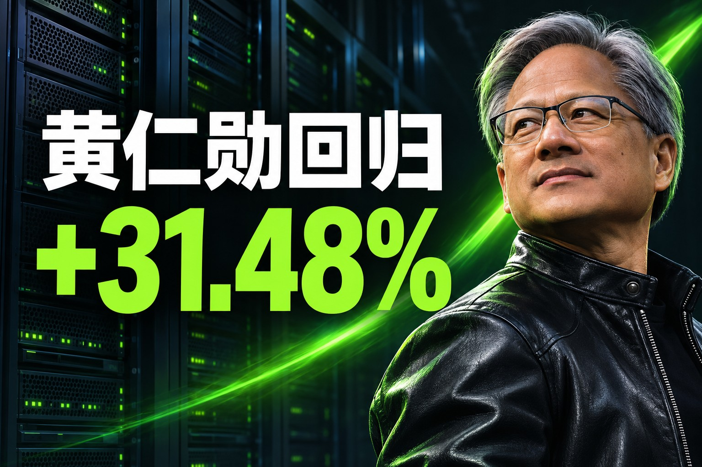
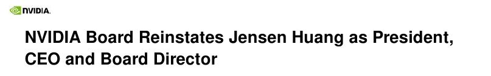
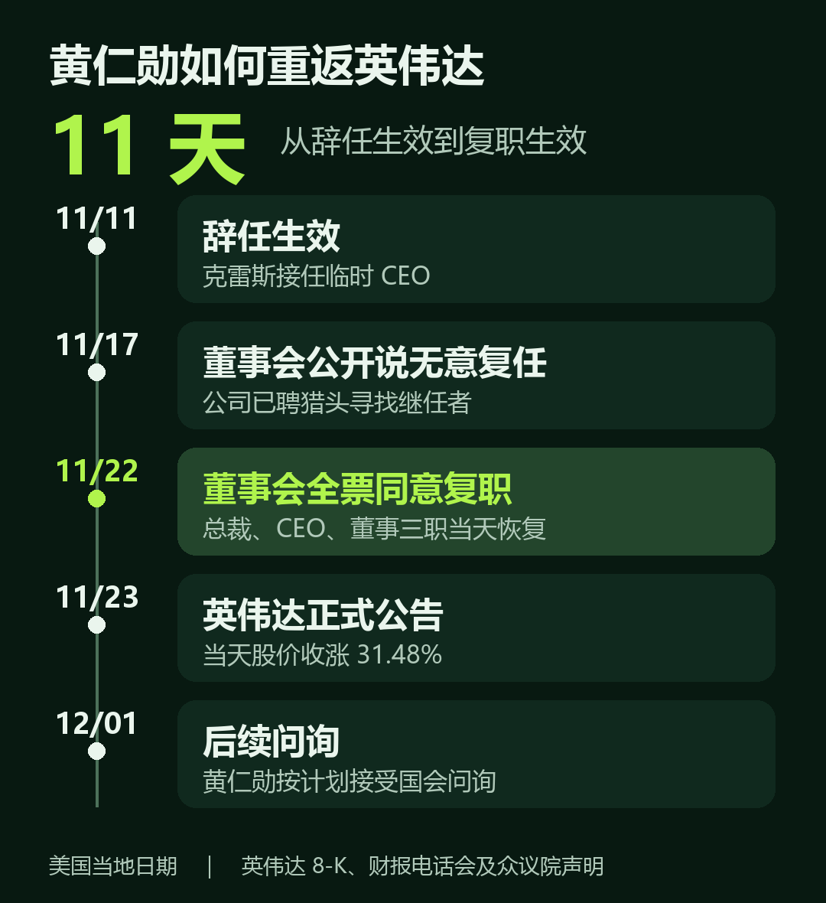
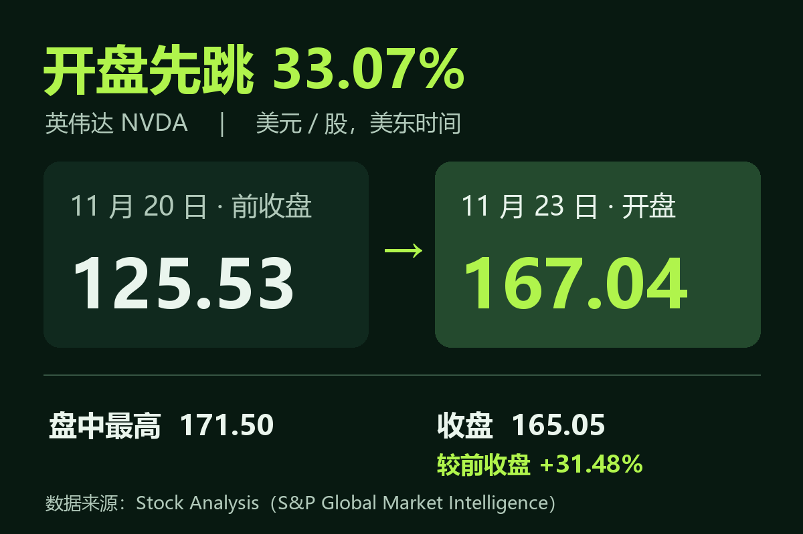

# 离任11天，黄仁勋全票回归！英伟达收涨31.48%

*题图为 AI 生成概念图。*

11 月 17 日，英伟达董事长还说，董事会无意让黄仁勋复任 CEO。

五天后，同一个董事会全票同意他回来。

**总裁、CEO、董事，三个职务一并恢复。**

11 月 23 日，英伟达对外公布这一决定。

当天美股收盘，英伟达收在 **165.05 美元，上涨 31.48%**。

*英伟达 11 月 23 日发布的复职公告*

黄仁勋在声明最后留了一句。

> 我迫不及待想回去工作。

## 同一个董事会，五天改了口

11 月 11 日，英伟达董事会接受黄仁勋辞任。

那天，科莱特·克雷斯以 CFO 的身份接任临时 CEO。

六天后，英伟达开财报电话会。

董事长哈维·琼斯说，董事会无意让黄仁勋复任 CEO。

英伟达甚至已经请了猎头，开始找正式继任者。

黄仁勋在当天的书面声明里说，如果董事会认为他的回归符合各方利益，他愿意回去。

11 月 20 日，一位自称持股近 15 年的股东给董事会写了封公开信。

他主张由股东选出的新董事决定黄仁勋能否回任。

这封信把讨论推到另一个问题：**谁来作这个决定？**

答案在两天后落定。

11 月 22 日，董事会一致同意恢复黄仁勋的三个职务，决定当天生效。

英伟达说，董事会在多轮会谈后重新认可他的领导能力，也听取了美国政府高层的意见。

克雷斯继续担任 CFO，琼斯继续担任董事长。

从辞任生效到复职生效，一共 **11 天**。

*资料来自英伟达两份 8-K、财报电话会、复职公告及美国众议院相关委员会声明。*

## 硅谷的反应，短到只剩一个名字

官宣之后，马斯克转发英伟达的帖子，配了一句：「错误已经纠正。」

OpenAI 的奥特曼在 X 上只发了一个名字：「Jensen!」

奥特曼自己也经历过董事会换帅。2023 年 11 月，OpenAI 在宣布他离任后，又宣布他回任 CEO。

同一条新闻中，董事会解释它为何改口，股东追问谁有权决定，硅谷同行则用几句话表达了欢迎。

## 31.48% 的涨幅，开盘时就有了

上周五，英伟达单日跌了 **14.01%**，股价收在 **125.53 美元**。

到了周一，第一笔正式交易的开盘价已是 **167.04 美元**。

两个价格之间，隔了 **41.51 美元**。

*美元／股，美东时间。数据来源：Stock Analysis，行情数据由 S&P Global Market Intelligence 提供。*

开盘较上次收盘高 **33.07%**，比全天最终涨幅还高。

同一天，纳指和标普 500 也分别上涨约 **6.5%** 和 **4.7%**。

市场一起反弹，英伟达这一只涨得更快。

股价很快给出了反应，董事会还有一件事要交代。

英伟达在复职公告中确认，独立董事委员会的调查将继续到结束。

公司还将招聘首席合规官，负责全公司的合规事务。

还有一个具体的日期可以看。

美国众议院三个委员会的主席说，黄仁勋仍将按原计划在 **12 月 1 日**接受有文字记录的问询。

公司调查何时结束，英伟达还没有给出时间。

主要出处｜英伟达公告与提交美国证交会的 8-K、英伟达财报电话会、Stock Analysis 历史行情。
